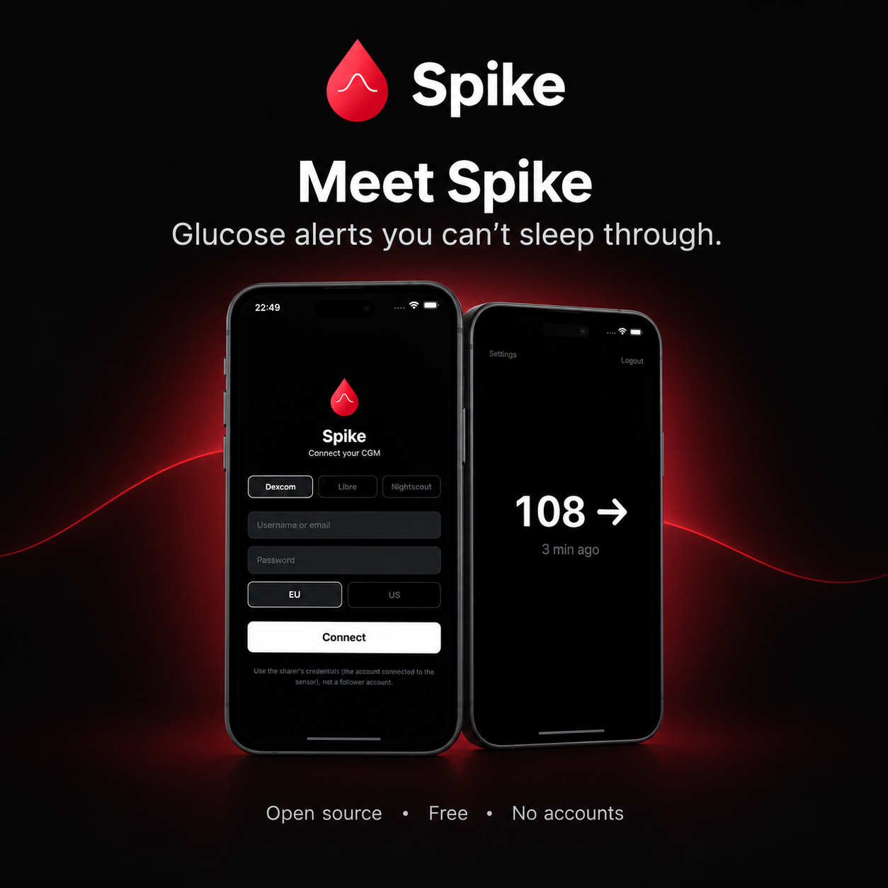

# Spike

**Your glucose, always in sight.**

Spike is an always-on glucose display and loud alarm for iOS and Android. Leave it open on your nightstand, kitchen counter or desk and see the current level, the trend and the sensor status at a glance, without unlocking your phone or opening an app. When something actually needs attention, the alarm is loud enough to wake you up.

Built for people with diabetes and the people who look after them.

<p align="center">
  
</p>

## Why Spike?

- **See it before the alarm goes off.** The trend is always visible, so you notice a rise or fall early instead of reacting when it's already urgent.
- **Know when the sensor stops sending data.** No reading is never mistaken for "everything is fine".
- **An alarm that actually wakes you up.** Default CGM alerts are easy to sleep through. Spike uses loud sounds and haptics that play even in silent mode.
- **No setup headaches.** Connect directly to your Dexcom Share or LibreLinkUp account. No Nightscout server required (though it's supported too).
- **Works on iOS and Android, in any country.**
- **Simple, modern interface.** One big number and a clear trend. Nothing else to configure unless you want to.

## Turn an old phone into a home glucose monitor

Have an old phone or tablet in a drawer? Install Spike, turn on **Keep screen on**, plug it in and put it where you spend your time. Everyone in the house can see the glucose level at a glance, and the alarm covers the night.

## Supported CGM sources

- **Dexcom Share** (G6, G7, ONE): tested
- **LibreLinkUp** (Libre 2, Libre 3): beta
- **Nightscout** (any CGM via your own instance): beta

> Only Dexcom Share has been tested with real hardware. LibreLinkUp and Nightscout are implemented from their public APIs but not yet verified. **Libre and Nightscout users: testers wanted!** Please [open an issue](https://github.com/balajsebastian/spike/issues) with your feedback.

## Features

- Large, readable glucose display, built for the nightstand and for a glance across the room
- Trend arrow and stale-data / sensor signal-loss indication
- Loud alarm with haptic feedback that plays even in silent mode
- Multiple alarm sounds (Beep, Double Beep, Arcade, Siren, Chime, Signal)
- Configurable thresholds (urgent low, low, high)
- Trend alerts (rapid rise/fall)
- Snooze (1–15 min, default 5)
- Keep screen on, landscape and tablet support
- Dark and light themes
- mg/dL and mmol/L units
- No data collection: credentials stay on your device

## Important: keep Spike open

Alarms only work while Spike is open on screen. If you lock your phone, switch to another app, or close Spike, it stops checking your glucose and **will not alarm**. Leave it open with the screen on (Spike keeps the screen awake by default), ideally plugged in.

## Disclaimer

Spike is **not a medical device**. It displays glucose data from your existing CGM system. Do not make treatment decisions based solely on this app. Always verify with your official CGM app or a blood glucose meter.

## Privacy

No data is collected, stored, or transmitted. Your credentials are stored locally on your device using the OS secure keychain. Glucose data is fetched directly from your CGM provider. See [PRIVACY_POLICY.md](PRIVACY_POLICY.md) for details.

## Feedback

Found a bug or have a suggestion? Open an [issue](https://github.com/balajsebastian/spike/issues) or email balajdariussebastian@gmail.com.

## For developers

Spike is built with Expo / React Native. It uses native modules (expo-audio, expo-crypto, expo-haptics), so it needs a development build and will not work in Expo Go.

```bash
# Install dependencies
npm install

# Run on iOS simulator (requires Xcode)
npx expo run:ios

# Run on Android emulator (requires Android Studio)
npx expo run:android
```

### Building for production

```bash
npm install -g eas-cli
eas build --platform ios --profile production
eas build --platform android --profile production
```

Contributions are welcome.

## License

Copyright (C) 2026 Sebastian Balaj

Spike is free software: you can redistribute it and/or modify it under the terms of the GNU General Public License v3.0 or later. See [LICENSE](LICENSE).
